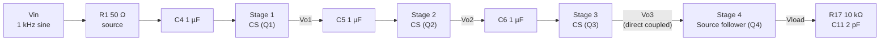

# MOSFET Amplifier Design Project

A multi-stage MOSFET amplifier designed and simulated in **KiCad 10** with the built-in ngspice simulator. The circuit runs from a single **3.3 V** supply and chains three common-source gain stages into a source-follower output buffer that drives a 10 kΩ || 2 pF load. It was built as the final project for ELE404.

## Circuit overview



| Stage | Device | Role | Gate bias divider | Drain resistor | Source resistor | Source bypass |
|-------|--------|------|-------------------|----------------|-----------------|---------------|
| 1 | Q1 (W = 5.5 µm, L = 0.5 µm) | Common source | R2 1.8 MΩ / R3 800 kΩ | R4 33 kΩ | R5 1.5 kΩ | C8 10 µF |
| 2 | Q2 (W = 5.5 µm, L = 0.5 µm) | Common source | R6 1.8 MΩ / R7 800 kΩ | R8 33 kΩ | R13 1.5 kΩ | C10 10 µF |
| 3 | Q3 (W = 5.5 µm, L = 0.5 µm) | Common source | R9 1.8 MΩ / R10 800 kΩ | R14 33 kΩ | R11 1.5 kΩ | C7 10 µF |
| 4 | Q4 (W = 16.65 µm, L = 0.5 µm) | Source follower (output buffer) | R15 220 kΩ / R16 800 kΩ | tied to VDD | R12 11 kΩ | none |

**Key points**

- **Supply:** V1 = 3.3 V DC.
- **Input:** V2 is a 0.5 mV, 1 kHz sine source with a 1 V AC magnitude for AC analysis, in series with a 50 Ω source resistance (R1) and a 1 µF coupling capacitor (C4).
- **Inter-stage coupling:** stages 1 to 3 are AC coupled with 1 µF capacitors (C5, C6). Stage 3 drives stage 4 directly, and R15/R16 set the Q4 gate bias.
- **Load:** R17 = 10 kΩ in parallel with C11 = 2 pF on the `Vload` node.
- **Devices:** all four transistors use the `nmos_3p3` SPICE subcircuit (3.3 V NMOS model) through KiCad's `NMOS_Substrate` symbol.

**Labelled nets** (probe these in the simulator): `Vo1`, `Vo2`, `Vo3`, `Vload`.

## Repository contents

| File | Description |
|------|-------------|
| `MOSFET Amplifier Design Project.kicad_pro` | KiCad project file |
| `MOSFET Amplifier Design Project.kicad_sch` | Schematic (the full amplifier) |
| `MOSFET Amplifier Design Project.kicad_pcb` | PCB file (empty, no layout yet) |
| `MOSFET Amplifier Design Project.kicad_prl` | Local KiCad project settings |
| `MOSFET Amplifier Design Project.wbk` | Saved simulator workbook (AC plot setup) |

## Getting started

### Requirements

- [KiCad 10](https://www.kicad.org/download/) (the project files were saved with KiCad 10.0)
- The `nmos_3p3` SPICE model file (`nmos_t.txt`). **It is not included in this repo**, so add it before simulating.

### Run the simulation

1. Clone the repo and open `MOSFET Amplifier Design Project.kicad_pro` in KiCad.
2. Place `nmos_t.txt` somewhere accessible (for example, next to the project files).
3. Open the schematic. For each of Q1 to Q4, open **Properties → Simulation Model** and point **Library** at your copy of `nmos_t.txt`. The model name is `nmos_3p3` and the pin mapping is `1=d 2=g 3=s 4=b`.
4. Open **Inspect → Simulator**.
5. Load the saved workbook `MOSFET Amplifier Design Project.wbk` (**File → Open Workbook**), or set up the analysis manually as shown below.

### Analysis settings

The saved workbook runs an AC sweep:

```
.ac dec 10 10 1Meg
```

This covers 10 Hz to 1 MHz with 10 points per decade. The plot shows the gain (magnitude) of `V(/Vo1)`, `V(/Vo2)`, `V(/Vo3)` and `V(/Vload)`, so you can see the gain build up stage by stage and where the bandwidth rolls off.

## Results

> Add your simulation results here: mid-band gain per stage, overall gain, −3 dB bandwidth, DC operating point, and so on. For example:
>
> ```
> 
> ```

## Notes

- **Model path:** the SPICE library path in the transistor properties was set on the original author's machine and is an absolute Windows path, so it will not resolve on other computers. Update it as described above.
- **Nominal bias:** ignoring loading, the first three stage dividers set the gate near 3.3 V × 800 kΩ / 2.6 MΩ ≈ 1.0 V, and the Q4 divider sets it near 3.3 V × 800 kΩ / 1.02 MΩ ≈ 2.6 V.
- **PCB:** the `.kicad_pcb` is a placeholder, and no board layout has been done.

## License

Add a license of your choice (for example, MIT) before publishing. See [choosealicense.com](https://choosealicense.com/).
